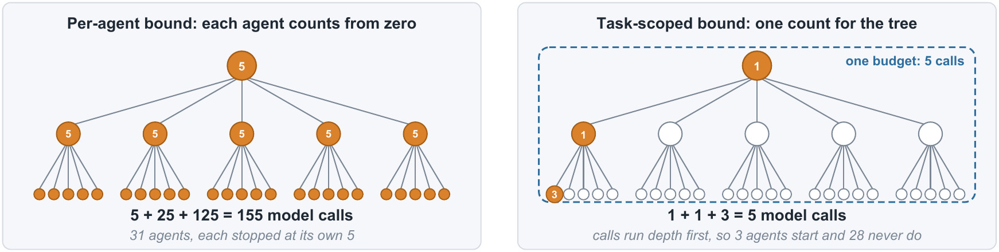

# BROODS: Bounds Resist Only One Delegation Step

[](LICENSE)
[](pyproject.toml)
[](https://github.com/SRINJOY59/BROODS/releases)

Code for the paper **Bounds That Do Not Compose: Measuring OS-Inspired
Containment in Agent Frameworks**, Srinjoy Das and Sourangshu Bhattacharya,
IIT Kharagpur. NeurIPS 2026 Workshop on AgenticOS.

BROODS is a conformance suite of eleven probes. Each probe asks one agent
framework for one containment property modelled on what an operating system
gives a process: an iteration limit, a deadline, a token budget, cancellation
of spawned work, isolation, accounting and so on. It then drives the framework
with a fault injector that never lets an agent stop on its own, and counts what
actually reaches the network.

<p align="center">
  
</p>

Every framework enforces its iteration limit within one run. An agent called as
a tool starts a run of its own, so the limit restarts at every level of
delegation. With a declared limit of 5 and a model that always delegates, the
left tree makes 155 model calls. A single budget scoped to the whole task, the
right tree, stops at 5.

## Results

Model calls at the socket for a declared limit of 5, by delegation depth:

| System | Depth 0 | Depth 1 | Depth 2 | Depth 3 |
|---|---:|---:|---:|---:|
| AutoGen 0.7.5, PydanticAI 2.35.0, OpenAI Agents SDK 0.22.0 | 5 | 30 | 155 | 780 |
| CrewAI 1.15.17 | 6 | 36 | 186 | not run |
| smolagents 1.26.0 | 6 | 36 | 186 | 936 |
| LlamaIndex 0.14.24 | 5 | 25 | 105 | 425 |
| LangGraph 1.2.11 | 3 | 9 | 21 | 45 |
| baseline (40-line control loop) | 5 | 30 | 155 | 780 |
| baseline with one task-scoped budget | 5 | 5 | 5 | 5 |

The full matrix of 88 cells. L0: the property cannot be requested. L1: it can
be requested but had no effect. L2: enforced only after an overshoot. L3: holds
for one run but not across delegation. L4: holds for the whole delegation tree.

| System | spawn | deadline | token | context | concurrency | rate | cancel | fault | state | accounting | reclaim |
|---|---|---|---|---|---|---|---|---|---|---|---|
| baseline | L3 | L1 | L0 | L0 | L0 | L0 | L1 | L1 | L1 | L1 | n/a |
| LangGraph | L3 | L1 | L0 | L0 | L3 | L3 | L1 | L1 | L1 | L4 | L4 |
| CrewAI | L3 | L1 | L1 | L0 | L0 | L2 | L0 | L3 | L1 | L1 | L2 |
| AutoGen | L3 | L1 | L3 | L0 | L0 | L0 | L1 | L3 | L1 | L1 | L4 |
| PydanticAI | L3 | L0 | L2 | L2 | L1 | L0 | L1 | L1 | L1 | L1 | L4 |
| OpenAI Agents | L3 | L0 | L0 | L0 | L0 | L0 | L1 | L3 | L1 | L1 | L4 |
| smolagents | L3 | L0 | L0 | L0 | L0 | L0 | L0 | L3 | L1 | L0 | n/a |
| LlamaIndex | L3 | L3 | L0 | L0 | L0 | L2 | L0 | L3 | L1 | L0 | L4 |

Handoffs, which pass control within one run, held the bound in the two
frameworks where we tested them. Every nesting construct we tested multiplied
it unless the caller's budget was passed in by hand. TaskScope
(`broods/scope.py`), a budget scoped to the task and enforced at the HTTP
client, held the declared call limit on all eight systems once its context was
carried across threads.

## Installation

BROODS needs Python 3.10 or later. The harness uses only the standard library.
Each framework under test runs in its own virtual environment, because the
frameworks pin incompatible versions of `openai`, `pydantic` and
`langchain-core`.

```bash
git clone https://github.com/SRINJOY59/BROODS.git
cd BROODS
pip install -e ".[dev]"
bash scripts/setup_envs.sh        # one venv per framework under .venvs/
```

`requirements/<framework>.txt` holds the frozen dependency closure of each
environment. On Windows, run the shell scripts from Git Bash.

## Quick start

The test suite runs offline in a few seconds and needs no framework. It checks
the fault injector, the scoring rules and an end-to-end `spawn` run on the
standard-library control.

```bash
pytest
```

Run one probe on chosen systems, or the whole matrix:

```bash
broods-probe --probe spawn --frameworks baseline langgraph --depths 0 1 2
broods-matrix --trials 3          # writes results/full/matrix_<stamp>.json
broods-table results/full/matrix_<stamp>.json
```

`broods-table` recomputes every level from the raw rows with the current
scoring rules. Given several bundles, each later one replaces the cells it
contains, so a targeted re-run can be layered over a full matrix.

Nothing above calls a model provider. Live validation needs an OpenRouter key
in a `.env` file at the repository root (`OPENROUTER_API_KEY=...`):

```bash
broods-matrix --probes spawn --real-probes spawn
```

## Reproducing the paper

`bash scripts/reproduce_paper.sh` regenerates every measurement in a few hours.
The results used in the paper are attached to the
[v1.0.0 release](https://github.com/SRINJOY59/BROODS/releases) as
`broods-results-v1.0.0.zip`. Its `INDEX.txt` maps each table to its files.
To rebuild Table 2 from that archive:

```bash
unzip broods-results-v1.0.0.zip
broods-table results/full/matrix_20260922T224109Z.json \
             results/full/matrix_20261006T113628Z.json \
             results/full/matrix_20261013T213213Z.json
```

| Paper item | Command |
|---|---|
| Tables 2 and 3 | `broods-matrix --trials 3`, then `broods-table` |
| Growth-law check | `python -m broods.analyze --bundle latest --holdout` |
| Table 4, delegation constructs | `.venvs/<fw>/Scripts/python broods/native/<script>.py` |
| Table 6, capability audit | `.venvs/<fw>/Scripts/python broods/audit_caps.py <fw>` |
| Table 8, TaskScope | `python -m broods.experiments.scope_eval --trials 3` |

On Linux and macOS the environment interpreter is `.venvs/<fw>/bin/python`.
Every result bundle records the git commit, the interpreter and the frozen
packages of each environment it used.

## How it works

```
broods-matrix ──> fault injector and observer (local, OpenAI-compatible)
              └─> one subprocess per framework venv ──> adapter ──> framework ──┘
```

* **The proxy** (`broods/proxy.py`) answers every model request with another
  tool call, so any stop is the framework's doing, and it counts every request
  that reaches the socket. Each reply reports a fixed usage of 28 tokens, so the
  token probes test whether a framework sums the usage it is told.
* **Probes** (`broods/probes/`) are written once against a uniform adapter
  interface and never import a framework. Each one declares a bound, builds a
  delegation tree of fixed shape, injects a workload and scores the result.
* **Adapters** (`broods/frameworks/`) know how one framework spells a bound and
  builds an agent, and otherwise keep the framework's defaults.
* **Levels** come from fixed rules in each probe's `verdict()`, documented in
  Appendix D of the paper and pinned by `tests/test_verdicts.py`.

### Adding a framework or a probe

A framework is one file, `broods/frameworks/<name>/adapter.py`, implementing
`FrameworkAdapter` from `broods/frameworks/base.py`: `version`, `supports`,
`make_agent` and `invoke`, and optionally `start`, `cancel`, `join` and
`report_usage`. Add its frozen environment to `requirements/` and its name to
`FRAMEWORKS` in `broods/runner.py`.

A probe is one class in `broods/probes/<name>/probe.py` with `run` and
`verdict`, registered in `broods/probes/__init__.py`.

## Repository structure

```
broods/
  proxy.py, proxy_client.py   fault injector and observer
  runner.py, run_all.py       run one probe, or the full matrix
  table.py                    recompute levels from result bundles
  probes/                     the eleven probes and their scoring rules
  frameworks/                 one adapter per system
  scope.py                    TaskScope, the task-scoped budget
  native/                     each framework's own delegation constructs
  audit_caps.py               capability audit behind every L0
  experiments/                TaskScope evaluation and extended studies
requirements/                 frozen environment for each system
scripts/                      environment setup and full reproduction
tests/                        offline tests
assets/                       README figure
```

`broods/experiments/` also holds studies for an extended version of this work:
protocol hops, live branching, older releases and a repository audit.

## Limitations

* Every count is a ceiling under a model that always delegates. A live model
  delegates less.
* Cancellation is issued by the harness, which starts children on its own
  threads. Framework-native parallel primitives are not exercised.
* The capability audit reads signatures, so a bound reachable only through
  `**kwargs` can escape it, as LlamaIndex's iteration limit did.
* TaskScope gates model requests made through the HTTP clients it wraps. It does
  not stop a tool that is already running, and it shares the address space of
  every tool, so it is not a sandbox.

## Citation

```bibtex
@inproceedings{das2026broods,
  title     = {Bounds That Do Not Compose: Measuring {OS}-Inspired Containment in Agent Frameworks},
  author    = {Das, Srinjoy and Bhattacharya, Sourangshu},
  booktitle = {NeurIPS 2026 Workshop on AgenticOS: Co-designing Systems and ML Foundations of an OS Layer for Agentic AI},
  year      = {2026}
}
```

## License

MIT. See [LICENSE](LICENSE). Questions and bug reports are welcome as
[GitHub issues](https://github.com/SRINJOY59/BROODS/issues).
